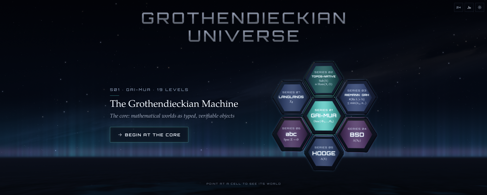

  

  
  
  
  
  
  
  

  <b><a href="https://grothendieck.space/">Play in the browser</a></b> ·
  <a href="#the-seven-worlds">Worlds</a> ·
  <a href="#how-a-level-teaches">How a level teaches</a> ·
  <a href="#what-this-repository-is">The repository</a> ·
  <a href="README.zh-CN.md">中文</a>

 

# Grothendieckian Universe

*A puzzle game of the seven works of The Grothendieckian Programme.*

**Grothendieckian Universe** is a browser puzzle game built from the seven published works of
[The Grothendieckian Programme](https://alienmuse.space/) by Vincent Liu. Each of its seven worlds is one work;
each of its 57 levels is one idea from that work; each of its 221 puzzles asks the player to do the thing the idea
does — glue local pieces that agree, locate what fails to glue, move a problem into a world where it can be
answered, and say exactly what the move cost.

It is free to play, runs entirely in the browser, needs no account, and speaks English and Chinese.

> *Pieces that agree where they meet glue into one; a piece that does not can be pointed at, and the pointing is
> the answer.*

## At a glance

<table>
  <tr>
    <td align="center"><b>7</b> worlds, one per work</td>
    <td align="center"><b>57</b> levels</td>
    <td align="center"><b>221</b> puzzles</td>
    <td align="center"><b>32</b> kinds of puzzle in the kernel</td>
    <td align="center"><b>3</b> journeys: Roaming · Exploring · Rising Sea</td>
    <td align="center"><b>245</b> quotations checked word for word</td>
  </tr>
</table>

## The seven worlds

Each world is one work. The levels open in order — S01, then S02, then the four works on open problems in any
order, then S07 — and progress is saved automatically.

| | World | The work | Levels | The idea the world teaches |
|---|---|---|---|---|
| **S01** | The Grothendieckian Machine | *GAI-MUA*, six volumes | 19 | Descent: pieces that agree where they meet are one object; the failure to agree is an obstruction with a location |
| **S02** | Topos-Native Intelligence | *GM-Ω∞*, five volumes | 16 | A context is a site, its evidence a sheaf, its conclusion a global section — and the classifier knows every sub-object |
| **S03** | Arithmetic Spectral Descent | *ASD* | 4 | What symmetry does and does not fix; an index bound, not a positivity, and a bridge whose last span is dashed |
| **S04** | Fractured Adelic Geometry | *FAG* | 4 | Everywhere local, nowhere global; the rank-one barrier of every Gross–Zagier theorem |
| **S05** | The Archimedean Prism | *TAP* | 5 | Where projectivity is consumed, and what a proof is worth on a four-rung ladder of trust |
| **S06** | Strained Prismatic Geometry | *SPG* | 4 | abc: free for polynomials because they have a derivative; the integers have no base to differentiate over |
| **S07** | The Arithmetic Topos | *TAT* | 5 | Reciprocity, traces that count fixed points, and a ledger in which no printed mark is stronger than its proof |

## How a level teaches

A level is four puzzles — *introduce, develop, twist, conclude* — and a boss level closes each world with a
final puzzle that requires everything the world taught. A puzzle is never explained before it is played:

1. **The board** asks one question. The player moves the pieces — tap a cell, push two together, draw a path,
   turn an arrow, choose among options.
2. **The proposer** offers two hints, each a step of guidance rather than the answer: the first says where to
   look, the second names the relation that decides it.
3. **A discovery card** confirms the answer with three things: the one-sentence idea, the formula the idea is,
   and a **quotation from the book itself**, with its chapter. A fourth line — *not established here* — says
   exactly what the level does **not** claim. That line is the discipline: a puzzle can teach an idea without
   pretending to prove it.
4. **A stamp** publishes the result. The ledger records every move, every hint, every stamp.

Every quotation is checked word for word against the printed source. Every claim outside the books is checked
against an external authority. Both are gates in the build, not intentions.

## Playing

- **In the browser:** [grothendieck.space](https://grothendieck.space/) — English by default; the **ZH** button in
  the top-right switches the whole interface, in place, without losing your place.
- **On a phone:** the same URL; the game is laid out for a phone in portrait and in landscape.
- **No installation, no account, no cookies, no tracking.** The game makes no request to any third-party origin:
  its fonts are bundled, its images are generated, its sound is synthesised in real time.

## What this repository is

This repository is the **public face of the game**: its banner, its licence, its policies, and a copy of the
built site that [GitHub Pages](https://pages.github.com/) serves. It is not the game's source.

The game's code — the kernel that decides whether a board glues, the 32 puzzle kinds, the level files, the
rendering, the audio synthesis, the gates that check them — is © Vincent Liu and is not published here. What is
published is the playable build and the words.

| Folder | What it holds |
|---|---|
| `site/` | the built game, exactly as deployed to grothendieck.space (HTML, CSS, JS, fonts, images) |
| `assets/` | the banner and the social preview image |
| `LICENSES/` | the third-party licences (three.js, the TGP faces, STIX Two Math, Orbitron) |

## Licence and rights

- **The game** — its code, design, levels, scenes, art and sound — © 2026 Vincent Liu. **All rights reserved.**
- **The game's own words** (level titles, lines, hints and the discovery cards): **CC BY-NC-ND 4.0**.
- **The quotations**: each is the book's own words, and keeps that book's licence as printed on its copyright
  page (CC BY-NC-ND 4.0 for all seven works).

**Free to do:** play it; teach with it in a class; stream it, record it, review it, and make videos about it,
including the usual revenue a creator's platform pays.

**Written permission first:** brand or commercial promotion; paid courses and training; commercial events;
any use of the game, its levels, art or sound in a commercial product or service; adaptations and ports.

**Not allowed:** copying, mirroring or republishing the game itself.

Requests: [vincent.liu@wisemotif.ai](mailto:vincent.liu@wisemotif.ai) · see [NOTICE.md](NOTICE.md) and
[TRADEMARKS.md](TRADEMARKS.md).

## Elsewhere in the Programme

- [**AlienMuse.space**](https://alienmuse.space/) — Vincent Liu's own site: the Programme, the works, the essays.
- [**Grothendieck Lab**](https://grothendiecklab.com/) — the Programme's official site: the seven works, their
  pages and their DOIs.
- [**The works this game is made from**](https://grothendiecklab.com/works/) — each work, its licence, its record.

## Security and authenticity

The authentic build is the one served from grothendieck.space and the one in `site/` of this repository. Reports
of copies sold or distributed with modifications, accounts impersonating the author, or files with matching names
but different contents: [SECURITY.md](SECURITY.md).
