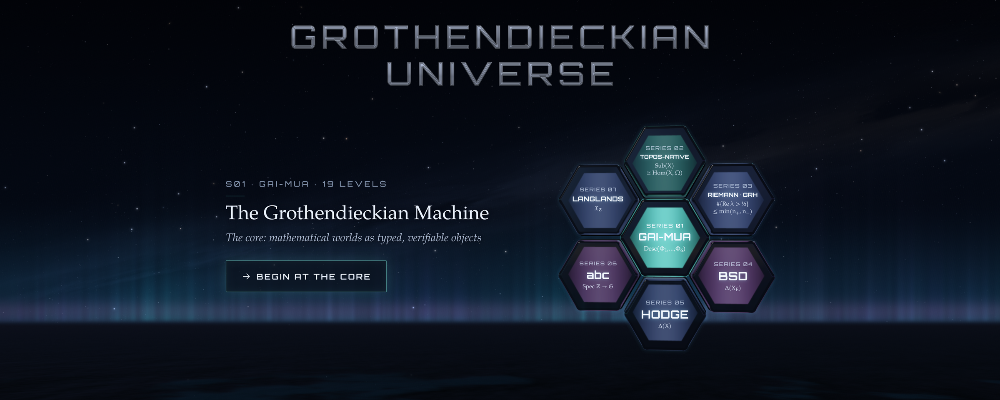

  

  
  
  
  
  
  
  

  <b><a href="https://grothendieck.space/zh/">开始游玩</a></b> ·
  <a href="#七个世界">七个世界</a> ·
  <a href="#游戏如何教授">游戏如何教授</a> ·
  <a href="#关于本仓库">关于本仓库</a> ·
  <a href="#许可与权利">许可</a> ·
  <a href="README.md">English</a>

 

# Grothendieckian Universe · 格罗滕迪克宇宙

**一部以 The Grothendieckian Programme 七部已出版著作为内容构造的益智解谜游戏。**

Grothendieckian Universe 是一款浏览器益智解谜游戏，取材于 Vincent Liu 的
[The Grothendieckian Programme](https://alienmuse.space/) 的数学内容。该 Programme 含七部著作，每部处理一个
问题，或一套关于机器推理的架构。本游戏把这部分内容转化为可交互的形式：一关并不概述一本书，而是要求玩家亲手
完成那本书所完成的运算——在数据相容处把局部数据粘合为整体，在不相容处定位其障碍，并把一个问题搬运到能够回答
它的设定之中，同时说明这一步的代价。

七个世界，一世界对应一部著作；五十七关，每关锚定该著作的一个思想；二百二十一道谜题，覆盖三十二种交互类型。
中英文均可游玩，免费，无需账号，不使用 Cookie，也不向任何第三方域名发出请求。

## 设计原则

游戏受四条约束支配，每条约束都由自动化检查强制执行，而非依赖编辑意图。

1. **每一关是它那本书的一个思想。** 关卡不是围绕某个机制添加的主题装饰；机制本身就是那个思想。书里证明定理的
   地方，关卡要求玩家在一个有限、完备的设定中完成相应的构造。
2. **每一条引文都是著作原话。** 每张发现卡以书中原句收尾，并标明章节。全部 245 条引文均已逐字对照印本核验。
3. **每一条书外主张都经过权威核验。** 点名的定理、数值事实与具名结果均对照外部文献核验，并登记在案。
4. **每一关都声明自己的边界。** 每张发现卡都有一行以"本关不确立"开头，精确说明该关**没有**主张什么。一关可以
   教授一个思想，而不必主张该思想所属的定理。

## 七个世界

世界按顺序开放：先 S01，再 S02，然后四部关于未决问题的著作可任选顺序，最后 S07。进度自动保存。以下每个世界
以三件事说明：它所操作的数学对象、玩家在该对象上执行的运算，以及该世界教玩家定位的障碍。

| | 世界 | 著作 | 关数 | 对象 · 运算 · 障碍 |
|---|---|---|---|---|
| **S01** | The Grothendieckian Machine | *GAI-MUA*（六卷） | 19 | **对象：**环或空间的局部块所构成的覆盖。**运算：**把一族局部截面在每一处重叠上粘合——先限制，再比较，最后发布一个整体截面。**障碍：**五道关卡中最先失败的那一道（限制、共同点、相容、唯一、存在），以及在 Boss 关中只有先粘合核心才能闭合的三重交叠上闭链。 |
| **S02** | Topos-Native Intelligence | *GM-Ω∞*（五卷） | 16 | **对象：**一个 site、其上的预层，以及子对象分类子。**运算：**从证据原子组装覆盖，把取值搬运进共享茎，粘合为截面或算出阻止粘合的那个类；随后按 site 的各阶段做迫降，判定命题。**障碍：**神经上一个非零上同调类——即使两两与三重都相容，整体仍不可粘合。 |
| **S03** | Arithmetic Spectral Descent | *ASD* | 4 | **对象：**非定二次型下 Frobenius 算子的谱。**运算：**在有限域上数曲线的点数，观察 ζ 函数的根落在圆 \|α\| = √q 上；再转动二次型，追踪特征值穿过临界线的位置。**障碍：**一个指标界 min(n₊, n₋) 而非正性——以及一座桥，其最后一跨是从开放假设出发的已证蕴涵，因而留作虚线。 |
| **S04** | Fractured Adelic Geometry | *FAG* | 4 | **对象：**ℚ 上的一条椭圆曲线，连同它在每一处的局部点。**运算：**逐个素数检验局部可解性，用弦与切线法则做点加法，并对指定曲线比较 BSD 恒等式两侧的数。**障碍：**一个在每一处都平凡、却在整体上非平凡的 Tate–Shafarevich 类——处处局部、处处非整体——以及使一切 Gross–Zagier 定理止步于第一阶导数的秩一屏障。 |
| **S05** | The Archimedean Prism | *TAP* | 5 | **对象：**把 Hodge 猜想表述为一台四步机器，每一步消耗不同的假设。**运算：**定位那唯一需要丰沛类的一步，再把关于它的每一条主张放到四级信任阶梯上——计算、圈定、精确核验、形式化内核。**障碍：**一个在余维二及以上仍未决的正性命题，以及一个被精确命名却未被合上的缺口。 |
| **S06** | Strained Prismatic Geometry | *SPG* | 4 | **对象：**abc 猜想，以及本可使其可证的导子。**运算：**搜寻高质量三元组，在定理成立的域上比较多项式的次数，并尝试构造 ℤ 的一个非零导子。**障碍：**整数的一切导子都是零——整数没有可供求导的基——因此任何替代品都必须改变定律或改变对象。 |
| **S07** | The Arithmetic Topos | *TAT* | 5 | **对象：**一条算术曲线，连同它在每个素数处与无穷远处的局部图卡。**运算：**数椭圆曲线的点数并展开其 L 级数的系数，核验两者一致；再用"一减迹加行列式"数环面自同构的不动点。**障碍：**主猜想——在游戏收束的账本上标为 *C*——以及一部章程：任何印出的状态都不得强于其证明所支撑的程度。 |

最终关 **S07-05《算术曲线》** 是全游戏的收束 Boss：玩家由局部图卡组装出整体，并照原样发布这份账本——虚线留在
数学本身留下它的位置。

## 游戏如何教授

每一关由四道谜题组成，遵循引入、展开、转折、收束的顺序；每个世界以一个 Boss 关收尾，其最后一题要求用到该世界
教过的全部运算。

**棋盘。** 一道谜题给出一个问题与一个小而完备的结构：有限环、空间的覆盖、证据的神经、小域上的曲线、点格、
矩阵对。玩家直接作用于该结构——选取格子、把两块推合、画出路径、转动箭头、把主张分入不同的格，或在几条形式
陈述中选择一条。

**提议者。** 玩家可请求两级提示：第一级指出应当看哪里，第二级点出决定该问题的那个关系；两者都不直接给出答案。
使用提示会记入账本，并影响发现卡上显示的"诚实"评级。

**发现卡。** 成功游玩后打开一张卡片，含四项内容：一句话的思想、该思想对应的公式、著作原句（连同章节），以及
说明本关不确立什么的边界句。卡片是教学的单位；边界句是使教学保持诚实的那一项。

**账本。** 每一步移动、每一次求助、撤销、重开与盖章都被记录。一关的发布状态——完成、最少步、诚实——由账本
推出，而非人工设定。

## 游玩

- **在浏览器中：** [grothendieck.space/zh/](https://grothendieck.space/zh/)（中文）或
  [grothendieck.space](https://grothendieck.space/)（英文）。默认语言为英文；点击右上角的 **EN / ZH**
  可在**当前页面原地**切换整套界面，不重新加载页面，也不丢失当前谜题的状态。
- **在手机上：** 同一网址。版式同时适配竖屏、横屏手机与桌面。
- **可访问性与隐私：** 游戏可用键盘操作，遵循系统的"减少动态效果"偏好；不使用 Cookie，不做跟踪，不向自身
  域名之外发出任何请求。字体随包提供，图像在构建时生成，声音实时合成。

## 关于本仓库

本仓库是游戏的公开门面：包含许可、各项政策、Banner，以及由 GitHub Pages 托管的构建产物。它不包含游戏的源码。

引擎——判定一个配置能否粘合的内核、三十二种谜题、关卡定义、渲染、声音合成，以及核验它们的自动化检查——
版权归 Vincent Liu，未在此公开。

| 路径 | 内容 |
|---|---|
| `site/` | 构建好的游戏，与部署到 grothendieck.space 的逐字节一致，含 `site/zh/` 下的中文页 |
| `assets/` | Banner 与分享预览图 |
| `LICENSES/` | 第三方许可：three.js（MIT）、TGP 字体（GUST）、STIX Two Math 与 Orbitron（SIL OFL 1.1） |
| `NOTICE.md` | 各部分许可，以及须获授权的用途 |
| `SECURITY.md` | 报告仿冒、被改动的副本与安全问题 |
| `TRADEMARKS.md` | 名称与标识允许的使用方式 |
| `CITATION.cff` | 采用 Citation File Format 的引用信息 |

## 许可与权利

- **游戏本身**——代码、设计、关卡、场景、美术与音效：© 2026 Vincent Liu，**保留全部权利**。
- **游戏自身的文字**——关卡标题、一行字、提示与发现卡：**CC BY-NC-ND 4.0**。
- **引文：**均为所属著作的原话，并遵循该著作版权页所印的许可（七部均为 CC BY-NC-ND 4.0）。

**无需申请即可进行：**游玩；在课堂上使用；直播、录屏、评测与制作评述，包括平台支付的常规收益。

**须先获书面授权：**品牌或商业推广；付费课程与培训；商业活动；把游戏、其关卡、美术或音效纳入商业产品或服务；
改编与移植。

**不允许：**全部或部分复制、镜像或重新发布本游戏。

授权联系：[vincent.liu@wisemotif.ai](mailto:vincent.liu@wisemotif.ai)。详见 [NOTICE.md](NOTICE.md) 与
[TRADEMARKS.md](TRADEMARKS.md)。

## Programme 的其他入口

- [**AlienMuse.space**](https://alienmuse.space/) —— 作者个人主页：整个 Programme、各部著作与文章。
- [**Grothendieck Lab**](https://grothendiecklab.com/) —— Programme 的官方站点：七部著作、它们的页面与 DOI。
- [**本游戏取材的著作**](https://grothendiecklab.com/works/) —— 每一部著作、其许可与记录。

## 真伪

正版构建是 https://grothendieck.space/ 所提供的那一份，以及本仓库 `site/` 中的那一份。关于被改动的副本、冒充
作者的账号，或名称相同而内容不同的文件，按 [SECURITY.md](SECURITY.md) 处理。
